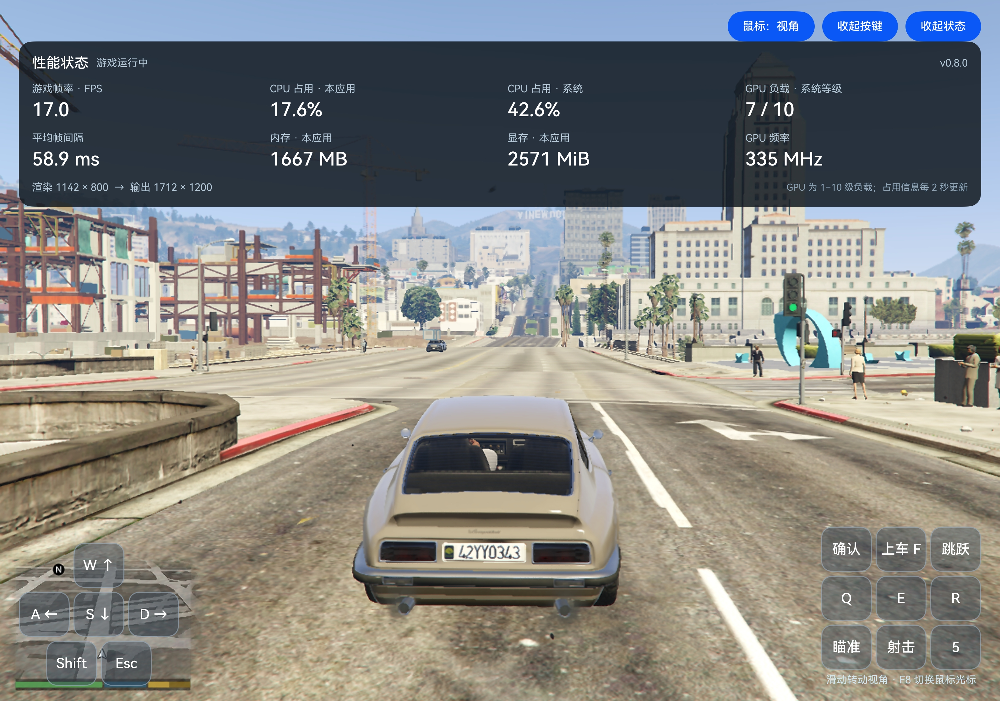
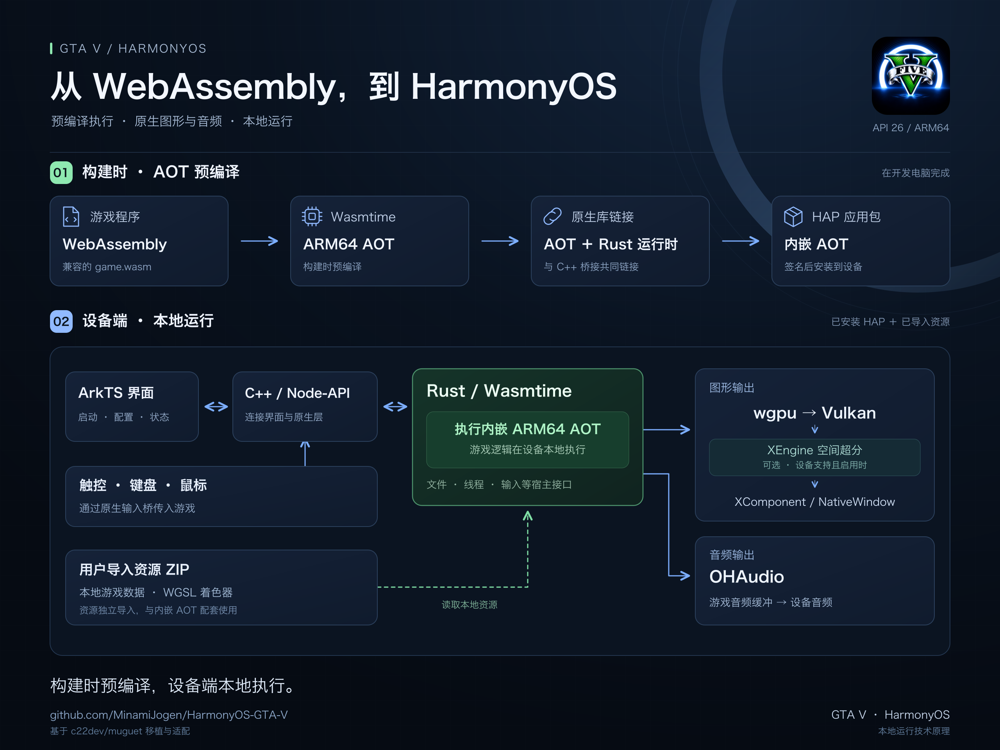

# 鸿蒙原生 GTA V


在鸿蒙设备上原生本地运行的GTA 5！

非模拟器，非串流。面向 **HarmonyOS API 26 / ARM64** 的 GTA5 WebAssembly 运行环境，包含原生渲染、音频和触控操作适配，适配华为 XEngine 空间超分。

本项目已可以在设备上正确运行，支持外接键盘鼠标，存档/键位等游玩细节仍在打磨中！

如果您觉得本项目非常有趣，欢迎您点一个star🌟持续关注！

## 更新记录

### v1.0.1

- 优化运行时性能和启动界面，添加画质预设。
- 接入实验性 AI 2× 补帧；需要设备支持相应模型和运行环境，实际效果因设备与场景而异。
- 添加加载和导入存档、开始新游戏及开始 Demo 功能。

## 当前性能

在 9050 Pro (Mate XT 2) 性能模式下，低画质原生800p，XEngine超分1200p，一般游戏环境内约 15 FPS。此数据来自此前版本，不代表本次更新的实测性能。



## 如何使用

**为了避免侵权，本项目不提供游戏原文件**，所提供的适用于HarmonyOS的编译后文件仅供学习交流，禁止用于盈利或其他用途。

- **(可选)自行编译游戏数据**：安装 DevEco Studio，使用仓库提供的构建工具：

  ```sh
  git clone https://github.com/MinamiJogen/HarmonyOS-GTA-V.git
  cd HarmonyOS-GTA-V

  # 先检查本机编译环境，不会下载或安装工具
  bash tools/build_game.sh --check

  # 用自己准备的兼容游戏 ZIP：校验、提取、生成 AOT、编译并打包
  bash tools/build_game.sh --zip /absolute/path/your-game.zip

  # 已有 game.wasm 时，也可直接指定
  bash tools/build_game.sh --wasm /absolute/path/game.wasm
  ```

- **(可选)下载已编译数据**：

  如果您觉得本项目非常有趣，欢迎您点一个star🌟持续关注！

  百度网盘：https://pan.baidu.com/s/1r8P7o1K349NNUFa5IxhOBQ?pwd=2nhf

- **导入游戏文件**：

  安装应用：下载 Release 中的未签名 HAP 安装包，通过 DevEco 或 HDC 等工具安装。
  
  传入资源包：把游戏资源 ZIP 复制到设备文件管理App中，不用解压。
  
  导入资源：打开应用，点击“选择游戏 ZIP”，选中压缩包，等待导入和校验完成。
  
  开始游戏：首页显示资源就绪后，点击“开始游戏”。

  建议手机预留至少 35 GB 可用空间。游戏 AOT 已在安装包中，无需再次编译。游戏文件压缩包在导入后可以删除。

## 运行原理



[查看 SVG 矢量图](docs/assets/architecture-harmonyos.svg)

项目构建时，Wasmtime 将 WebAssembly 程序预编译为 ARM64 AOT 代码，再嵌入 HAP 的原生库并随应用签名；设备启动后执行这些预编译代码，无需在设备上进行 JIT 编译。

ArkTS 界面通过 C++ / Node-API 连接 Rust 运行时。运行时提供文件访问、线程和输入等宿主接口，通过 **wgpu → Vulkan → XComponent / NativeWindow** 呈现画面，通过 **OHAudio** 输出音频，并在设备支持时使用华为 XEngine 空间超分。

## 思路来源与致谢

本项目的思路灵感来源于 **[c22dev/muguet](https://github.com/c22dev/muguet)**，同时移植和修改了其运行时代码，并非仅参考概念。所用上游基线为 [`1a0300d3cfc5f87ce2fa1ccb365c013e5238e322`](https://github.com/c22dev/muguet/tree/1a0300d3cfc5f87ce2fa1ccb365c013e5238e322)。感谢原作者 Constantin Clerc（c22dev）及上游贡献者。

相对于上游，本项目主要增加了 HarmonyOS 应用壳、签名 AOT 的链接与加载、Vulkan 窗口、OHAudio、输入与生命周期适配，以及针对华为设备的渲染优化和空间超分支持。

## 开源协议

本项目的 Muguet 衍生代码及本项目新增代码采用 **GPL-3.0-or-later**，协议全文见 [LICENSE](LICENSE)。第三方代码保留各自的协议与版权声明，详见 [THIRD_PARTY_NOTICES.md](THIRD_PARTY_NOTICES.md)。

分发修改版源码或安装包时，需要保留版权、许可和免责说明，注明修改及日期，并按 GPL 提供对应版本的完整可修改源码和构建脚本。通过 Releases 分发二进制时，应同时提供对应源码的下载位置。不能仅注明作者或链接上游来替代这些义务；具体要求以 [GPLv3 原文](https://www.gnu.org/licenses/gpl-3.0.html)为准。

上述开源许可适用于本项目代码，不授予游戏程序、素材或商标的使用及再分发权。HarmonyOS / HMS SDK 和系统组件遵循其各自的条款；本项目与 Rockstar Games、Take-Two 无关联。
